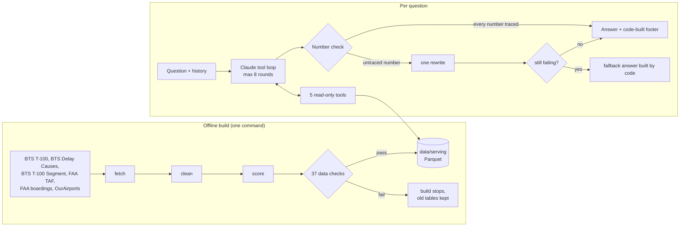

# Airport Investment Agent

A chat agent that helps an investor decide which US airports are worth putting modernization money into, answering in plain English from public BTS and FAA data, where code computes every number and the LLM never does.

Ask "Which airports in New England are strong candidates for terminal expansion?" or "What is the unmet flight demand at SFO and why?" and you get a verdict, the reasons, the caveats, and a footer built by code with the data period, assumptions and a computed confidence label. It covers all 402 FAA primary airports (343 fully ranked), a deterministic capacity-need score, five read-only tools, and a number check that refuses to show an answer containing a figure no tool returned. On the 26-question eval it passes 25 to 26 of 26 per run, with 0 untraceable numbers across roughly 2,500 numbers in answers.

I designed the architecture, the score and the guardrails, and built it with Claude Code as my pair.

## How it works



**1. Data pipeline.** `python -m airport_agent.pipeline.build` downloads six public sources, cleans each into one tidy table, computes metrics, scores, tiers and warnings, then runs 37 data checks. If any check fails the build stops and the previous serving tables stay in place. Everything that is a choice rather than a fact (windows, thresholds, cutoffs) lives in `config/settings.yaml`, and the metric catalog with weights lives in `config/metrics.csv`.

**2. The score.** For each airport: how strained its flight and passenger capacity is today, and how much demand is coming. Added capacity only gets filled where both are true.

| Side | Metric | Role | Source | Weight |
|---|---|---|---|---|
| Passenger | How full the planes are (passengers / seats, latest 12 months) | Strain today | BTS T-100 | 25% |
| | Passenger growth since 2019 | Demand, proven | BTS T-100 | 12.5% |
| | FAA forecast passenger growth, 2035 vs 2025 | Demand, expected | FAA TAF | 12.5% |
| Flight | System delay rate (airport and air-traffic delays / arrivals, three years) | Strain today | BTS Delay Causes | 25% |
| | FAA forecast flight growth, 2035 vs 2025 | Demand, expected | FAA TAF | 25% |

- Rank-based, 0 to 100: each metric is the airport's percentile among full-data airports, so one outlier cannot stretch the scale. Raw values are always shown next to the score.
- Missing data is never scored as 0. 343 airports get a full score, 55 a passenger-side score only, 4 none.
- Size stays out of the score. It is shown beside it, and national rankings are grouped by size class.
- Deterministic: pure Python, unit-tested, and the build scores twice and requires identical output.

**3. Five tools.** The model can only reach data through these, all read-only (`airport_agent/tools.py`):

| Tool | What it answers |
|---|---|
| `find_airport` | Resolves names, nicknames and codes ("LA", "Santa Ana", FAA vs BTS codes). Returns a default when one airport clearly dominates, or tells the model to ask (Portland, Oregon or Maine?) |
| `rank_airports` | Rankings by region, state, metro, size class or metric, plus threshold questions ("planes over 85% full") |
| `compare_airports` | Side by side on every metric, for any year |
| `airport_profile` | One airport in depth: score breakdown, long-haul share at any mile cutoff, airlines, cargo, warnings, unmet demand |
| `airport_trend` | A metric month by month over a chosen window |

A bad tool input comes back with the list of valid options, so the model corrects itself instead of failing.

**4. The agent loop.** A plain hand-written tool loop over the official Anthropic SDK, no framework, capped at 8 rounds (`airport_agent/agent.py`). Only `airport_agent/llm.py` knows the provider, so swapping the model is one environment variable. Old tool results are stubbed out after 3 data turns to keep the context short; the model is told to call the tool again if it needs them.

**5. Guardrails** (`airport_agent/safeguards.py`), none of which depend on the model behaving:

- **Number check.** Every number in the answer must match a number in a tool result still in the conversation (or the question itself). If not, the model gets one rewrite with the offending numbers listed. If it still fails, the user sees an answer built by code from the tool results.
- **Code-built footer.** Data period, assumptions and confidence come from the tool results, not from the model.
- **Computed confidence.** High / Medium / Low by fixed rules (data tier, sample size, warnings), never the model's opinion.
- **Warnings always shown.** Small samples, single-airline dependence, cargo-heavy traffic, BTS vs FAA disagreement and legal slot limits print under the answer whether or not the model mentioned them.
- **Prompt rule.** Numbers come only from tool results. Background knowledge is allowed only when labeled, and never with a number.

**6. Voice.** A microphone button opens a voice mode: local Whisper (faster-whisper) for speech to text, the same agent answers, and the browser reads a short summary aloud while the full answer and tables stay in the chat.

## Evals

`eval/questions.json` holds 26 questions in groups: core questions with follow-ups ("and at 2,000 miles?"), filters, time windows, ambiguous names, out-of-scope requests, judgment calls and awkward data. Each is graded by code on the outcome: the right tool and airports were used, the answer says what it must (regex rules), the number check passed without fallback, and the footer carries a confidence label.

Committed results in `eval/results/` (Claude Opus 5.5 unless noted):

| Run | Passed | Numbers in answers | Untraceable numbers | Passed after one rewrite |
|---|---|---|---|---|
| Full set, run A | 25 / 26 | 802 | 0 | 2 |
| Full set, run B | 26 / 26 | 933 | 0 | 3 |
| Full set, run C | 25 / 26 | 849 | 0 | 4 |
| Core questions + follow-ups | 7 / 7 | 241 | 0 | 0 |
| Core questions + follow-ups, Sonnet 5.5 | 7 / 7 | 223 | 0 | 1 |

Three earlier runs on a 24-question version of the set scored 23, 24 and 24. The one recurring miss is a judgment question (C6) where the grader expects the answer to mention a legal slot limit; the agent gives the evidence but sometimes leaves the word out. Average answer time is about 12 seconds with Opus and 7.6 with Sonnet, at roughly half the price.

Two more checks that do not come from the pipeline itself:

- **Hand check** (`eval/hand_check.md`): 4 figures read by hand off the FAA and BTS websites, with screenshots, all match exactly (plus 3 extra values on the same pages).
- **Weight robustness** (`eval/results/robustness.md`): every airport re-scored under 7 alternative weightings and windows. Rank correlation with the baseline stayed 0.96 to 0.99, and 31 to 37 of the 40 top-10 places (10 per size class) held. Halving the FAA forecast's weight moved the ranking most, so that is the choice that matters most.

## Tech stack

- Python 3.13
- Anthropic SDK (Claude Opus 5.5, swappable to Sonnet 5.5)
- pandas + pyarrow (Parquet), openpyxl, requests
- Streamlit (chat UI) with a small JS voice layer
- faster-whisper (local speech to text)
- pytest

## Engineering decisions and tradeoffs

| Chose | Gave up | Why |
|---|---|---|
| Five fixed tools, no free-form queries or text-to-SQL | Flexibility on unusual questions | Every number comes from tested code. Out-of-scope questions get an honest no with the closest available answer |
| Local data refreshed by one command, not live API calls | "Live" numbers | The sources update monthly, so live calls return the same numbers, only slower. A ranking needs all airports at once, which would be hundreds of calls per question. Local data also keeps answers repeatable |
| Parquet files, no database | Multi-user access, ad hoc SQL | 402 airports fit in memory and a clone runs with no setup. With many users I would move to a database |
| Rank-based scale, not min-max | The size of the gap between airports | One outlier cannot set the scale. Raw values are shown with the score |
| Three-year delay window | Recency | One year swings a lot. Three years is more stable and ranks 343 airports instead of 258 |
| Equal, untuned weights | A "fitted" model | There is no ground truth for renovation profit to tune against. Equal weights are an explicit default, and the robustness check shows which choice moves the result |
| Code-built footer and confidence | A more fluent answer | The parts an investor relies on most (period, assumptions, confidence) should not depend on the model |
| Hand-written tool loop, no agent framework | Prebuilt abstractions | The loop is about 120 lines, easy to test with a fake model, and the provider sits behind one file |

Where AI is used: understanding the question and the conversation, choosing the tool and its inputs, writing the explanation, and knowing when to ask or decline. Where it is not: it never computes, ranks or queries data.

## Problems hit and lessons

- **The model will compute if you let it.** Even with a hard prompt rule, some drafts contained a figure no tool returned (a difference, a rounded ratio). The number check caught every one; a single rewrite fixed each case across all runs, and the code-built fallback was never needed. The other half of the fix is tools that return the derived figures an answer needs (gaps, shares, changes). Lesson: a prompt rule is a request, a code check is a guarantee.
- **"How strained is the terminal?" has no public data.** There is no public gate, terminal or peak-hour data. I used load factor and system delay rate as proxies, and the agent is told to call a proxy a proxy every time.
- **Airport identity is messy.** BTS and FAA codes differ for some airports, cities have several airports, and nicknames are common. `find_airport` uses a code crosswalk, an alias list and a dominance rule for defaults, and asks when it is genuinely ambiguous.
- **Thin data looked confident.** Small airports produced extreme delay rates from a few hundred flights. Minimum sample sizes, a small-sample warning and data tiers fixed it, and missing data is never treated as zero.
- **Evals that grade the tool sequence are brittle.** The model sometimes takes an extra, reasonable step. Grading the outcome (right airports, right content, clean number check) made the eval stable across runs.
- **The pipeline needs its own ground truth.** Tests built from the pipeline's own tables only prove consistency, so I checked figures by hand against the source websites.

## Running it locally

Needs Python 3.13 and an Anthropic API key. The serving tables (about 2.4 MB of Parquet) are committed, so the chat runs right after a clone.

```bash
git clone https://github.com/eyal-gross/airport-investment-agent.git
cd airport-investment-agent

python -m venv .venv
source .venv/bin/activate          # Windows: .venv\Scripts\activate
pip install -r requirements.txt

cp .env.example .env               # Windows: copy .env.example .env
# set ANTHROPIC_API_KEY in .env

streamlit run app.py
```

Environment variables (see `.env.example`):

- `ANTHROPIC_API_KEY` - required
- `AIRPORT_AGENT_MODEL` - optional, defaults to `claude-opus-5-5`

Voice downloads a small Whisper model (about 140 MB) on first use. Chrome or Edge work best for reading answers aloud.

### Rebuilding the data from the public sources

The raw downloads (about 110 MB) are not in the repo. The pipeline fetches them:

```bash
python -m airport_agent.pipeline.build             # build from raw files in data/raw/, fetching any that are missing
python -m airport_agent.pipeline.build --refresh   # re-pull every source first, about 15 minutes
```

| Source | From |
|---|---|
| BTS T-100 airport-month summary (passengers, seats, flights) | data.bts.gov API |
| BTS Airline On-Time Delay Causes, one file per year from 2019 | transtats.bts.gov |
| BTS T-100 Segment (routes, airlines, cargo) for 2019, 2024, 2025, 2026 | transtats.bts.gov |
| FAA Terminal Area Forecast, 2025 edition | taf.faa.gov |
| FAA passenger boarding data, calendar 2025 | faa.gov |
| OurAirports and the BTS Master Coordinate table (codes, cities, metro areas) | ourairports.com data, transtats.bts.gov |

`data/serving/fetch_manifest.json` records the periods, source URLs, row counts and every check result of the build that produced the committed tables.

## Tests

```bash
pytest                       # 77 unit tests: formulas, scoring, the five tools, the safeguards, the agent loop. No API key needed
python eval/run_eval.py      # the 26-question eval against the real model (needs the API key)
python eval/run_eval.py --group core --model claude-sonnet-5-5   # core questions on another model
python eval/robustness.py    # weight sensitivity (needs a local data build)
```

## Project layout

```
app.py                     Streamlit chat screen
airport_agent/
  llm.py                   The only file that talks to the LLM provider
  agent.py                 The tool loop: question in, answer out, max 8 rounds
  safeguards.py            Number check, code-built footer, computed confidence, fallback answer
  tools.py                 The five read-only tools
  voice.py, voice_mode.js  Local speech to text, spoken summary, voice mode screen
  sources/                 One small downloader per public source
  pipeline/                fetch -> clean -> score -> checks, plus pure unit-tested formulas
config/                    Metric catalog and weights, thresholds, regions, aliases, legal limits
data/serving/              Pre-computed Parquet tables the tools read
eval/                      Questions, eval runner, robustness check, hand check, committed results
tests/                     pytest unit tests
```

## Status and what's next

Working end to end on data through mid-2026 (passengers through April 2026, delays through July 2026, routes for calendar 2025). Every answer states its data period. Known limits and next steps:

- The score ranks upside (how much added capacity would be filled), not return: there is no public renovation cost data. Adding cost or bond data would turn it into a real return estimate.
- Chat history is lost on a browser refresh. Next: persisted conversations.
- Questions outside the five tools (by airline or by route) are declined. Next: a route-level tool.
- Voice is turn-based (record, stop, wait), not streaming.
- Data refresh is manual. Next: a scheduled build that only publishes when all checks pass.

## License

MIT, see [LICENSE](LICENSE).
